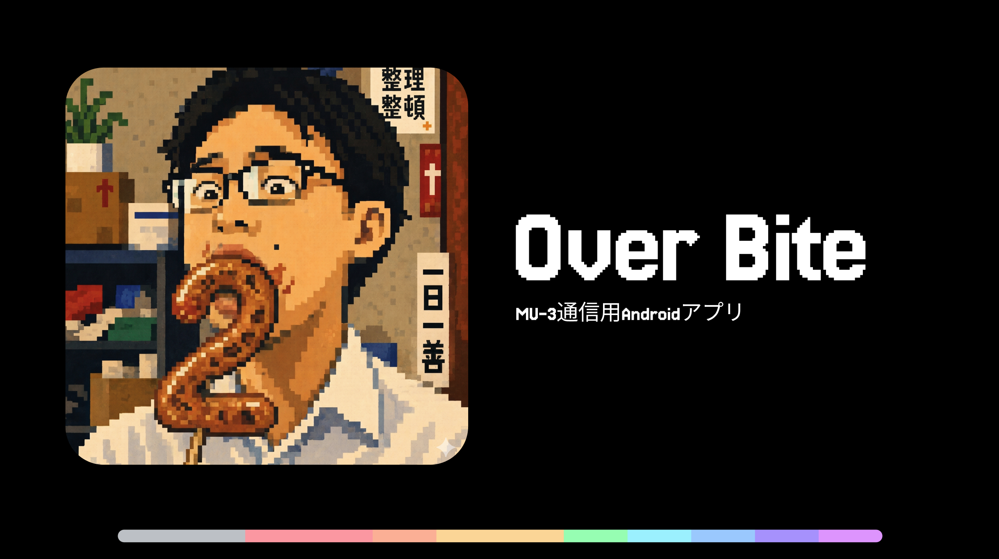

# Over Bite

[](https://github.com/chikun88/Over-Bite/actions/workflows/android.yml)

MU-3通信用のAndroidアプリ（ロボコン用途向け）。
ソースフォルダ名は `Mu3AndroidTx` です。

開発環境、テスト、APKビルド、Pull Requestの進め方は [開発手順](CONTRIBUTING.md) を参照してください。
以下は既存の機能説明と更新履歴です。現在のビルド環境は開発手順を基準にしてください。

AndroidスマートフォンをMU-3送信機として使うためのAndroid Studioプロジェクトです。

## 構成

```text
PS5 / DualSenseなどのゲームコントローラー
↓ Bluetooth / USB
Androidスマホ
↓ USB-OTG + USBシリアル
MU-3送信機
↓ 無線
MU-3受信機
↓ Raspberry Pi受信側
↓ ロボマス開発ボード
```

## 今回追加した機能

### 1. アプリ内で物理コントローラーのボタン割り当てを変更

メイン画面の **「割当 / MAPPING」** を押すと、以下のような割り当てを変更できます。

- × / A
- ○ / B
- △ / Y
- □ / X
- L1 / R1
- L2 / R2
- SHARE / OPTIONS
- PS
- L3 / R3
- 十字キー

それぞれのボタンを、以下の送信先に割り当て可能です。

- payload[4] bit0〜bit7
- payload[5] bit0〜bit7
- payload[6] bit0〜bit7
- 未割当 / OFF

### 2. アプリ内で画面上ボタンの割り当てを変更

画面上の機能ボタンは、アプリ内で以下を変更できます。

- 表示名
- 送信先bit
- HOLD / TOGGLE
- ボタン追加
- ボタン削除

最大12個まで画面ボタンを追加できます。

### 3. 設定保存

割り当て設定はAndroid端末内の `SharedPreferences` に保存されます。  
アプリを閉じても、次回起動時に同じ割り当てが復元されます。

## デフォルト割り当て

元のC++送信側と互換性があるように設定しています。

| 入力 | デフォルト送信先 |
|---|---|
| × | payload[4] bit5 |
| ○ | payload[5] bit2 |
| △ | payload[4] bit4 |
| □ | payload[5] bit3 |
| L1 | payload[4] bit3 |
| R1 | payload[4] bit2 |
| L2 | payload[4] bit1 |
| R2 | payload[4] bit0 |
| SHARE | payload[5] bit4 |
| OPTIONS | payload[5] bit5 |
| PS | payload[6] bit0 |
| L3 | payload[5] bit6 |
| R3 | payload[5] bit7 |
| 十字↑ | payload[4] bit6 |
| 十字↓ | payload[4] bit7 |
| 十字← | payload[5] bit1 |
| 十字→ | payload[5] bit0 |

画面ボタンF1〜F7は、デフォルトで `payload[6] bit1〜bit7` に割り当てています。

## ビルド方法

1. Android Studioでこのフォルダを開く
2. Gradle Sync
3. AndroidスマホをUSBデバッグ接続
4. Run

## 実機テスト時の注意

ロボットに載せる前に、必ずタイヤを浮かせてテストしてください。

特に割り当て変更後は、アプリの `Payload 7 bytes` 表示を見て、意図したbitだけがONになっているか確認してください。

## 通信形式

送信形式は元の送信側C++と同じで、7バイトpayloadを16進ASCII文字列にしてMU-3へ送ります。

例：

```text
@DT0E80808080000000\r\n
```

`0E` は16進文字列部分が14文字であることを示しています。


## Build fix notes

この版では次のビルド問題に対応済みです。

- AndroidX を有効化するため、`gradle.properties` に `android.useAndroidX=true` を追加
- Java/Kotlin の JVM target 不一致を避けるため、`app/build.gradle.kts` で Java/Kotlin ともに JVM 1.8 へ統一（JDK 17 がPCに無い環境でもビルドしやすくするため）

Android Studio で開いた後は、`File > Sync Project with Gradle Files` を実行してからビルドしてください。

## MU-3 TEST 実装版について

この版では、公式のMU評価アプリに近い診断機能をAndroidアプリ内に追加しています。

追加タブ：`MU-3 TEST`

実装済み機能：

- コマンドコンソール
  - 任意のMU-3コマンドを入力して送信
  - `@GI`, `@VR`, `@UI`, `@CH`, `@EI`, `@DI`, `@RA`, `@CR` のクイックボタン
  - MU-3からのレスポンスログ表示
- リンク設定
  - UI / GI / CH / EI / DI の入力欄
  - READ：現在値取得
  - APPLY：一時設定
  - SAVE /W：EEPROM保存。確認ダイアログあり
- 電波状況確認
  - `@RA` RSSI取得
  - `@CR` S/N確認
  - `@CH` + `@RA` による簡易チャンネルスキャン
- パケット試験
  - 元の操縦形式 `@DT0E + HEX ASCII` で7バイトpayloadを100回送信
  - `*DT` 応答数と `*IR` 系エラー数を表示

### 診断機能使用時の注意

`MU-3 TEST` の診断コマンドを実行するときは、自動的に操縦ストリームを停止する設計にしています。ロボットに接続した状態で診断コマンドを送る場合は、必ずタイヤを浮かせてテストしてください。

### 操縦データ通信形式

この版では、ユーザーの要望に合わせて操縦データを元々使用していた形式に戻しています。

```text
@DT0E + 7バイトpayloadをHEX ASCII化した14文字 + CRLF
```

ニュートラルpayloadは内部的には次の7バイトです。

```text
80 80 80 80 00 00 00
```

実際にMU-3へ送る文字列は次の形になります。

```text
@DT0E80808080000000\r\n
```

受信側Raspberry Piは、`*DR=0E80808080000000` のような受信文字列から14文字のHEXを取り出し、7バイトに戻して処理してください。

## 速度調整版について

この版では、ロボコン操縦時の体感ラグを小さくするために以下を追加しています。

- `SYSTEM` タブに `TX TUNING` を追加
- 送信周期をアプリ内で 10〜1000ms の範囲で調整可能
- UART通信速度をアプリ内で `1200/2400/4800/9600/19200/38400/57600bps` から調整可能
- `APPLY BAUD`：MU-3へ `@BRxx` を送り、Android側ポート速度も切り替え
- `SAVE BAUD`：確認後に `@BRxx/W` でMU-3へ保存
- `FAST PRESET`：57600bps / 30ms を一発設定
- 操縦ループを固定デッドライン方式にし、遅延時のcatch-up連送を防止
- UI更新を約8Hz程度に間引き、送信スレッドの負荷を低減
- フレーム長とボーレートに応じた動的write timeoutを使用
- ボーレートに対して物理的に厳しい送信周期は、安定送信できる下限へ自動補正

注意：通信速度をMU-3に保存した場合、次回起動時もその速度で接続する必要があります。接続できなくなった場合は、PCのTera Term等で現在のボーレートを合わせて設定を戻してください。

受信側Raspberry Piも、MU-3を57600bpsにする場合は `B57600` で開く必要があります。受信ループのsleepは50msではなく1〜5ms程度に下げると体感ラグが大きく減ります。

## 2026-05-31 Stability / Liquid UI update

この版では、要求事項に合わせて以下を追加・修正しました。

### MU-3通信安定化

- USBシリアルを閉じる前に送信スレッドを確実に停止し、ポートcloseとwriteの競合を防止。
- 診断コマンド・ボーレート変更の多重実行を `AtomicBoolean` でガード。
- TXループ内のRX drain待ち時間を指定時間内に制限し、1ms掃除が20ms待ちになる揺れを防止。
- `@DT0E` フレーム長とUART速度から最小安定周期を算出し、無理な周期設定を自動補正。
- 送信ループエラーをカウントし、`TX TUNING` のステータスに直近エラーを表示。
- NEUTRAL / EMERGENCY STOP / onPause時のニュートラル連送を別スレッド化し、UIフリーズを抑制。
- チャンネルスキャン範囲をMU-3想定の `02〜19` に制限。
- UI/GI/CH/EI/DI入力を16進数として検証し、不正な設定コマンド送信を防止。

### UI/UX refresh

- 角丸・半透明・ハイライト・リム光を重ねた `liquidGlassDrawable()` を追加。
- タブ、カード、ボタン、バッジ、非常停止ボタンをLiquid Glass風に刷新。
- 主要操作ボタンに軽いハプティックフィードバックを追加。
- ヘッダーを `OVERBITE / MU-3 LIQUID CONTROL` に変更し、視認性とブランド感を向上。

### Build compatibility

- Android Gradle Plugin 8.7.3 に合わせ、Gradle Wrapperを `8.9` に変更。
- AGP 8.7系はJDK 17実行が必要なため、コメントを修正。Android Studio同梱JDK 17でのビルドを想定。

## TELEMETRY / BLACK BOX タブ（テレメトリ＆ブラックボックス）

操縦を「見える化」し、試合後に振り返れるようにする新タブ `TELEMETRY` を追加しました。
他の操縦機能・通信形式（`@DT0E` + HEX ASCII）は一切変更していません。

### 1. ライブテレメトリ

送信中の通信状態をリアルタイムに表示します。

- **実測Hz** … 実際に送れている送信レート（設定周期と乖離していればラグの兆候）
- **リンク健全度 (ACK)** … 各フレーム送信後にMU-3から応答バイト（`*DT` など）が返ったかの割合。低下＝電波状況が悪い
- **直近エラー数** … 直近3秒の送信エラー
- **ライブグラフ**（オシロスコープ風・約9Hzで自動更新）
  - 線：送信間隔(ms)
  - 破線：目標送信周期
  - 紫の面：スティック活動量
  - 下帯：1フレームごとのリンク健全度（緑=ACK / 赤=欠落）
  - 縦の赤線：送信エラーが起きた瞬間（通信が切れた箇所が一目で分かる）

### 2. ブラックボックス記録

実際にMU-3へ送った7バイトpayload・送信間隔・ACK有無・エラー/目印イベントを、
端末メモリ上のリングバッファ（最大36000サンプル）に記録します。
送信スレッドへの影響を避けるため、確保ゼロのプリミティブ配列に書き込みます。

- **REC ● / STOP ■** … 記録の開始 / 停止
- **CLEAR** … 記録を消去
- **MARK 🚩** … 任意のタイミングで目印を記録（あとでリプレイ時に確認可能）
- **EXPORT** … CSVファイルとして保存し、保存パスをクリップボードへコピー
  - 保存先：`Android/data/com.chihaya.mu3androidtx/files/blackbox_<timestamp>.csv`
  - 列：`t_ms, lx, ly, rx, ry, p4_hex, p5_hex, p6_hex, gap_ms, ack, error, marker, rssi`

### 3. リプレイ

記録したセッションをシークバーで巻き戻し、各時点の操縦状態を再現表示します。
**リプレイ中はロボットへ一切送信しません（安全）。**

- 左右スティック位置と payload[4]/[5]/[6] の24ビットLEDで操縦状態を可視化
- `▶ PLAY` で記録を時系列再生、`⏮ / ⏭` で先頭・末尾、`LIVE` で最新サンプルへジャンプ
- 各フレームの時刻・送信間隔・ACK・目印/エラーをテキストでも表示

### 使い方の例

1. `SYSTEM` か `DASHBOARD` でMU-3に接続し送信開始
2. `TELEMETRY` タブで `REC ●` を押して記録開始
3. 走行・操縦する
4. `STOP ■` で記録停止 → `▶ PLAY` で振り返り、`EXPORT` でCSV保存して解析

## 2026-09-16 保存地点UI・圧力・仰角

保存地点ナビゲーション、圧力設定、仰角プリセットを搭載しています。操縦コマンドの符号化は `app/src/test` の単体テストで確認できます。
